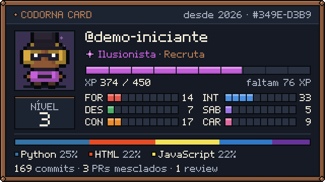
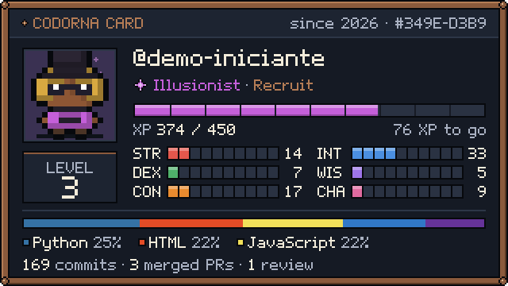
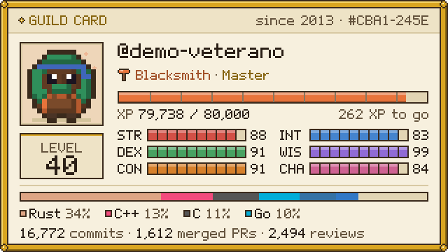

<div align="center">

<picture>
  <source media="(prefers-color-scheme: dark)" srcset="examples/veterano-dark-pt-BR.svg">
  
</picture>

# Codorna Card

**Sua atividade pública no GitHub vira um card de RPG em pixel art no README do seu perfil.**

[Português](#português) · [English](#english)

</div>

## Português

### O que é

Uma GitHub Action que lê a sua atividade **pública** no GitHub (commits, PRs, reviews, issues e
as linguagens dos seus repositórios) e desenha um card de RPG com **nível, XP, classe, patente e
seis atributos**. A arte é toda gerada por código: um avatar 16×16 único para o seu username,
moldura que muda com a patente e uma fonte em pixel desenhada para o projeto.

Roda no seu próprio repositório, uma vez por dia. Não tem servidor, não tem cadastro e nenhum
dado sai do GitHub.

<table>
  <tr>
    <td></td>
    <td></td>
  </tr>
</table>

### Instalação em um passo

No repositório do seu perfil (aquele com o mesmo nome do seu usuário, `seu-usuario/seu-usuario`),
copie [`examples/workflow.yml`](examples/workflow.yml) para `.github/workflows/codorna-card.yml`.

Pronto. O card é gerado todo dia e comitado como `codorna-card.svg`. Para mostrar no README:

```markdown

```

Não quer esperar o agendamento? Vá em **Actions → Codorna Card → Run workflow**.

O essencial do workflow é isto:

```yaml
name: Codorna Card
on:
  schedule:
    - cron: '23 4 * * *'
  workflow_dispatch:
permissions:
  contents: write
jobs:
  codorna-card:
    runs-on: ubuntu-latest
    steps:
      - uses: GabrielKoglin/codorna-card@v1
```

### Tema claro e escuro

Com `theme: both` a Action gera `codorna-card-dark.svg` e `codorna-card-light.svg`. Use os dois com
`<picture>` e o GitHub escolhe o certo para o tema de quem visita:

```yaml
- uses: GabrielKoglin/codorna-card@v1
  with:
    theme: both
```

```html
<picture>
  <source media="(prefers-color-scheme: dark)" srcset="codorna-card-dark.svg" />
  
</picture>
```

Os dois temas têm fundo próprio, então qualquer um deles também fica legível sozinho.

### Entradas

| Entrada    | Padrão              | O que faz                                                                                                                      |
| ---------- | ------------------- | ------------------------------------------------------------------------------------------------------------------------------ |
| `username` | dono do repositório | Login do GitHub cuja atividade vira o card.                                                                                    |
| `token`    | `GITHUB_TOKEN`      | Token para ler a API e comitar. O padrão basta; não precisa de token pessoal.                                                  |
| `output`   | `codorna-card.svg`  | Caminho do SVG no repositório. Com `theme: both` vira `<nome>-dark.svg` e `<nome>-light.svg`.                                  |
| `theme`    | `dark`              | `dark`, `light` ou `both`.                                                                                                     |
| `lang`     | `pt-BR`             | Idioma do card, dos logs e da mensagem de commit: `pt-BR` ou `en`.                                                             |
| `commit`   | `true`              | Comita o SVG no repositório onde o workflow roda. Com `false`, só grava o arquivo no workspace (para você usar em outro step). |

Saídas: `level`, `xp`, `class`, `class-name`, `rank`, `files` e `committed`. O resumo do job
mostra a conta do XP linha por linha.

### Regras (resumo)

| Atividade                                  |           XP | Teto contra farm                     |
| ------------------------------------------ | -----------: | ------------------------------------ |
| Commit                                     |            2 | 10 por dia                           |
| Issue aberta                               |            4 | 150 por ano                          |
| PR aberto                                  |            5 | 250 por ano                          |
| Review de PR                               |            8 | 250 por ano                          |
| PR mesclado                                |          +10 | até o número de PRs abertos contados |
| PR mesclado no repositório de outra pessoa | +10 de bônus | idem                                 |

- **Nível:** chegar ao nível N custa 50 × (N − 1)² XP, até o 99.
- **Patente:** Recruta, Aprendiz, Veterano, Mestre, Lenda e Mítico. A moldura muda de madeira
  para bronze, prata, ouro, jade e ametista.
- **Classe:** pela família da linguagem dominante (cada repositório vale um voto). Ferreiro
  (C, C++, Rust…), Ilusionista (JS, TS, HTML, CSS…), Alquimista (Python, R, Julia…), Arcanista
  (Haskell, Elixir, Clojure…), Guardião (Java, C#, Scala…), Inventor (Swift, Kotlin, Dart…),
  Druida (Shell, Docker, Nix…), Patrulheiro (Go…), Mercador (PHP, Ruby, Solidity…), Bardo (TeX,
  Lua, GDScript…), Vidente (SQL, GraphQL…) e Aventureiro.
- **Atributos (1 a 99):** FOR (commits), DES (PRs mesclados), CON (dias com commit),
  INT (linguagens principais), SAB (reviews) e CAR (issues e colaboração em projetos de outras
  pessoas). Não dão XP.

Tudo em detalhes, com as fórmulas: [`docs/regras.md`](docs/regras.md).

### Perguntas frequentes

**Usa dados privados?** Não. Repositórios privados são descartados mesmo que o token consiga
vê-los, e as contribuições privadas anônimas do perfil não entram.

**Preciso criar um token pessoal?** Não. O `GITHUB_TOKEN` do próprio workflow lê os dados
públicos e comita o card. Só precisa de `permissions: contents: write` (já está no exemplo).

**O commit diário vai inflar as minhas contribuições?** Não. O commit é feito em nome do
`github-actions[bot]` e só acontece quando o card muda.

**Por que meus números não batem com o gráfico do perfil?** O gráfico pode incluir
contribuições privadas e não tem tetos. O card usa só o que é público e aplica os tetos contra
farm. O total público de cada tipo aparece no resumo do job.

**Posso usar em uma organização?** O card é de pessoas. Em um repositório de organização,
informe o seu login em `username`.

**Quanto tempo leva?** A Action faz uma consulta por ano de conta, mais as de repositórios,
uma de cada vez para respeitar os limites da API. Contas antigas levam mais que contas novas.

**E se eu bater no limite da API?** A Action tenta de novo nas falhas temporárias e, se o limite
acabar, mostra a hora em que ele renova. O próximo agendamento resolve sozinho.

**Funciona em runner próprio (self-hosted)?** Sim, desde que o runner esteja atualizado e
suporte `node24`, o runtime de Actions em JavaScript mais novo do GitHub.

**Dá para usar fora do GitHub Actions?** O código é uma biblioteca comum em TypeScript
(`src/`). O caminho suportado, por enquanto, é a Action.

### Como contribuir

Contribuições são bem-vindas: linguagens que faltam no mapa de classes, arte, traduções,
correções. Veja o [CONTRIBUTING.md](CONTRIBUTING.md). Comandos principais:

```bash
npm ci
npm test        # testes (sem chamar a API)
npm run demo    # gera os exemplos em examples/
npm run build   # empacota a Action em dist/
```

### Créditos

Feito por [Gabriel Koglin](https://github.com/GabrielKoglin). Toda a arte (avatar, emblemas,
molduras e fonte) é original e gerada por código. Licença [MIT](LICENSE).

---

## English

### What it is

A GitHub Action that reads your **public** GitHub activity (commits, PRs, reviews, issues and
the languages of your repositories) and draws an RPG card with **level, XP, class, rank and six
attributes**. All the art is generated by code: a unique 16×16 avatar for your username, a frame
that changes with your rank and a pixel font made for this project.

It runs in your own repository once a day. No server, no sign-up, and no data leaves GitHub.

<table>
  <tr>
    <td></td>
    <td></td>
  </tr>
</table>

### One-step install

In your profile repository (the one named after your user, `your-user/your-user`), copy
[`examples/workflow.yml`](examples/workflow.yml) to `.github/workflows/codorna-card.yml`.

That's it. The card is generated every day and committed as `codorna-card.svg`. To show it in your
README:

```markdown

```

Don't want to wait for the schedule? Go to **Actions → Codorna Card → Run workflow**.

For an English card, add `lang: en`:

```yaml
- uses: GabrielKoglin/codorna-card@v1
  with:
    lang: en
```

### Light and dark themes

With `theme: both` the Action writes `codorna-card-dark.svg` and `codorna-card-light.svg`. Use them
with `<picture>` and GitHub picks the right one for each visitor's theme:

```html
<picture>
  <source media="(prefers-color-scheme: dark)" srcset="codorna-card-dark.svg" />
  
</picture>
```

Both themes have their own background, so either one is also readable on its own.

### Inputs

| Input      | Default            | What it does                                                                                                                              |
| ---------- | ------------------ | ----------------------------------------------------------------------------------------------------------------------------------------- |
| `username` | repository owner   | GitHub login whose activity becomes the card.                                                                                             |
| `token`    | `GITHUB_TOKEN`     | Token to read the API and commit. The default is enough; no personal token needed.                                                        |
| `output`   | `codorna-card.svg` | SVG path in the repository. With `theme: both` it becomes `<name>-dark.svg` and `<name>-light.svg`.                                       |
| `theme`    | `dark`             | `dark`, `light` or `both`.                                                                                                                |
| `lang`     | `pt-BR`            | Language of the card, logs and commit message: `pt-BR` or `en`.                                                                           |
| `commit`   | `true`             | Commits the SVG to the repository running the workflow. With `false`, it only writes the file to the workspace (for another step to use). |

Outputs: `level`, `xp`, `class`, `class-name`, `rank`, `files` and `committed`. The job summary
shows the XP math line by line.

### Rules (summary)

| Activity                               |        XP | Anti-farm cap                          |
| -------------------------------------- | --------: | -------------------------------------- |
| Commit                                 |         2 | 10 per day                             |
| Opened issue                           |         4 | 150 per year                           |
| Opened PR                              |         5 | 250 per year                           |
| PR review                              |         8 | 250 per year                           |
| Merged PR                              |       +10 | up to the number of counted opened PRs |
| PR merged in someone else's repository | +10 bonus | same                                   |

- **Level:** reaching level N costs 50 × (N − 1)² XP, up to 99.
- **Rank:** Recruit, Apprentice, Veteran, Master, Legend and Mythic. The frame goes from wood to
  bronze, silver, gold, jade and amethyst.
- **Class:** from the family of your dominant language (each repository is one vote). Blacksmith
  (C, C++, Rust…), Illusionist (JS, TS, HTML, CSS…), Alchemist (Python, R, Julia…), Arcanist
  (Haskell, Elixir, Clojure…), Guardian (Java, C#, Scala…), Tinkerer (Swift, Kotlin, Dart…), Druid
  (Shell, Docker, Nix…), Ranger (Go…), Merchant (PHP, Ruby, Solidity…), Bard (TeX, Lua,
  GDScript…), Seer (SQL, GraphQL…) and Adventurer.
- **Attributes (1 to 99):** STR (commits), DEX (merged PRs), CON (days with commits), INT (main
  languages), WIS (reviews) and CHA (issues and collaboration on other people's projects). They
  don't give XP.

Full details and formulas (in Portuguese): [`docs/regras.md`](docs/regras.md).

### FAQ

**Does it use private data?** No. Private repositories are dropped even if the token can see
them, and the anonymous private contributions on your profile are not counted.

**Do I need a personal token?** No. The workflow's own `GITHUB_TOKEN` reads public data and
commits the card. It only needs `permissions: contents: write` (already in the example).

**Will the daily commit inflate my contributions?** No. The commit is authored by
`github-actions[bot]` and only happens when the card changes.

**Why don't my numbers match my profile graph?** The graph may include private contributions
and has no caps. The card only uses public data and applies the anti-farm caps. The job summary
shows the public total of each type.

**Can I use it for an organization?** Cards are for people. In an organization repository, set
your own login in `username`.

**How long does it take?** The Action makes one query per year of account age, plus the
repository queries, one at a time to respect API limits. Older accounts take longer.

**What if I hit the API rate limit?** The Action retries temporary failures and, if the limit
runs out, tells you when it resets. The next scheduled run fixes it on its own.

**Does it work on self-hosted runners?** Yes, as long as the runner is up to date and supports
`node24`, GitHub's newest runtime for JavaScript actions.

### Contributing

Contributions are welcome: missing languages in the class map, art, translations, fixes. See
[CONTRIBUTING.md](CONTRIBUTING.md). Main commands:

```bash
npm ci
npm test        # tests (no API calls)
npm run demo    # writes the examples in examples/
npm run build   # bundles the Action into dist/
```

### Credits

Made by [Gabriel Koglin](https://github.com/GabrielKoglin). All the art (avatar, emblems, frames
and font) is original and generated by code. [MIT](LICENSE) license.
